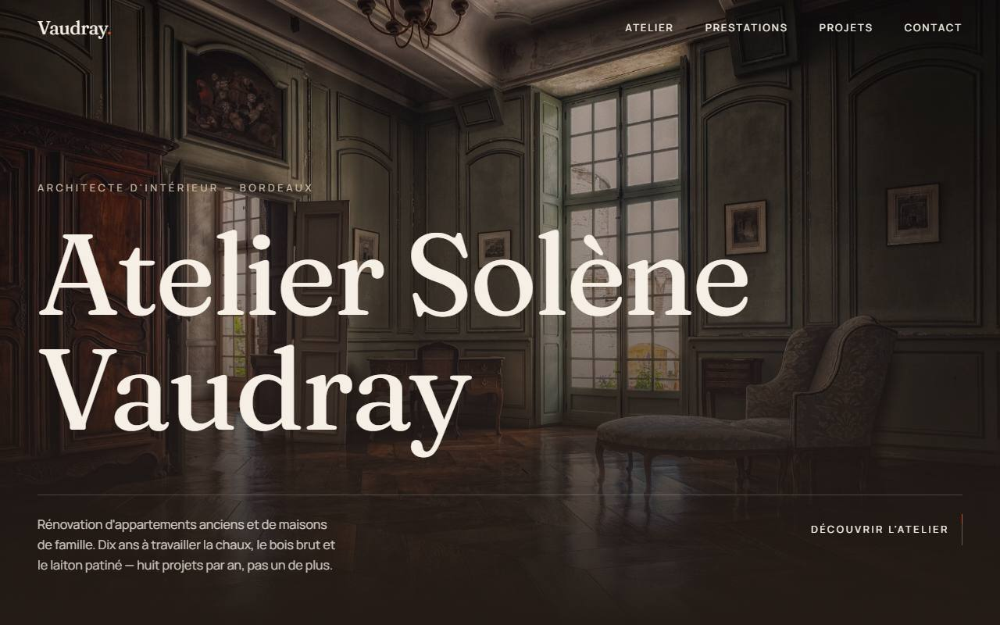
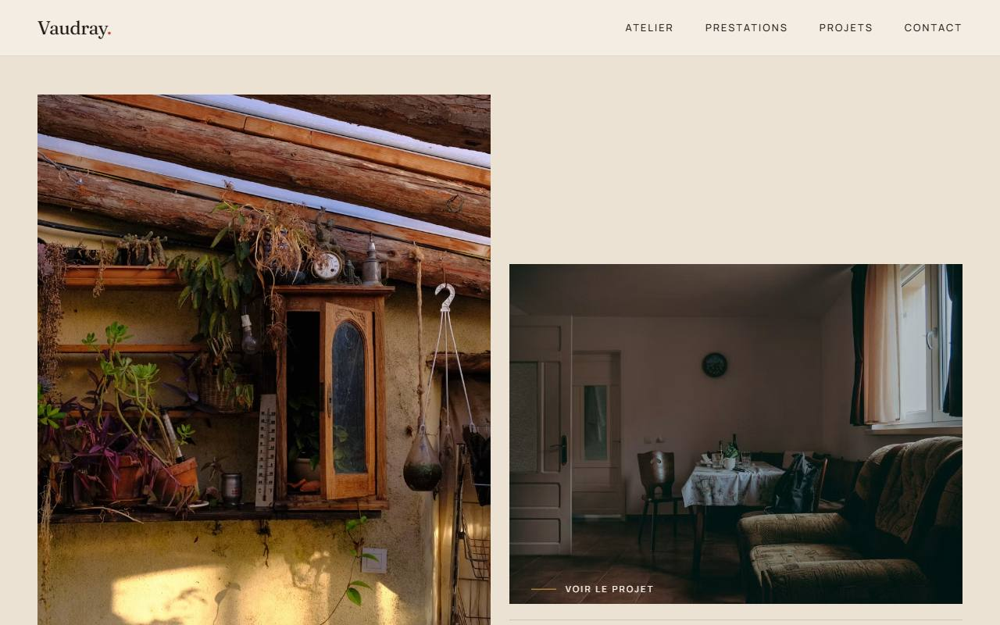

# Atelier Solène Vaudray — one-page showcase site / site vitrine one-page

**A demo showcase website for a fictional independent interior architect in Bordeaux.**
**Site vitrine de démonstration pour une architecte d'intérieur indépendante fictive, à Bordeaux.**

> **Demonstration project — Atelier Solène Vaudray is not a real business.**
> **Projet de démonstration — Atelier Solène Vaudray n'est pas une entreprise réelle.**
> Content, projects and testimonials are invented. / Le contenu, les projets et les
> témoignages sont inventés.

🔗 **Live demo / Démo en ligne** : _to be filled in after deployment / à compléter après le déploiement_

[English](#english) · [Français](#français)




---

## English

### What it demonstrates

- **A committed visual identity** — earth-and-lime palette, a typeface with character,
  generous spacing — deliberately away from the default SaaS grey and blue.
- **Animations that serve the content**: masked title reveals, light parallax, staged
  scroll-triggered entrances, and a shared-element transition carrying a project
  thumbnail into its full-screen view.
- **Technical restraint**: ~115 KB of gzipped JS, self-hosted fonts, no 3D library,
  sized images (no layout shift on load).
- **Respect for visitor preferences**: `prefers-reduced-motion` reduces everything to
  plain fades, and expensive effects are disabled on mobile.

### Stack

| | |
|---|---|
| UI | React 19 + TypeScript |
| Build | Vite |
| Styling | Tailwind CSS v4 (palette declared in `@theme`) |
| Animation | Framer Motion — no 3D library |
| Fonts | Fraunces (WONK axis) and Manrope, variable, self-hosted through Fontsource |
| Hosting | Vercel (static site) |

No CMS, no backend, no database: all content is hard-coded in `src/data/site.ts`.

### Getting started

```bash
npm install
npm run dev      # development server
npm run build    # type-check, then production build
npm run preview  # serve the local build
```

### Deployment

The repository deploys as is on Vercel: the platform detects Vite, runs `npm run build`
and publishes `dist/`. `vercel.json` only adds long-lived caching for build-hashed
assets.

### Pitfalls worth knowing before editing

Four issues that each required a real browser to diagnose:

- **Image reveal threshold** — `auScrollImage` uses `amount: 'some'`. An initial
  `clip-path` reduces an element's visible area to zero, so a percentage threshold is
  never crossed: the animation deadlocks, waiting to be visible in order to reveal
  itself.
- **Title masks** — lines are cropped by `overflow-hidden`. Real glyph descent was
  measured on canvas (0.26em, plus 0.12em of leftward overhang in italics), hence the
  `pb-[0.34em] / pl-[0.14em]` offset by matching negative margins. The size class must
  stay on the heading itself: if it sits on the animated span, the mask's `em` values
  resolve against the inherited size and descenders get sliced.
- **Word-by-word reveals** — `whitespace-pre` is required; a trailing space inside an
  `inline-block` box is dropped by the browser and words run together.
- **Hover versus entrance** — the entrance animation and the hover states live on two
  separate elements, otherwise Framer's variant sets override each other.

---

## Français

### Ce que le projet démontre

- Une **identité visuelle assumée** — palette terre et chaux, typographie à caractère,
  espacements généreux — à l'opposé du gris/bleu SaaS par défaut.
- Des **animations qui servent le contenu** : révélation des titres par masque,
  parallaxe légère, apparition progressive au scroll, et une transition partagée qui
  emmène la vignette d'un projet vers sa vue plein écran.
- Une **tenue technique** : ~115 Ko de JS compressé, polices auto-hébergées, aucune
  librairie 3D, images dimensionnées (pas de décalage de mise en page au chargement).
- Le **respect des préférences du visiteur** : `prefers-reduced-motion` ramène tout à
  de simples fondus, et les effets coûteux sont désactivés sur mobile.

### Stack

| | |
|---|---|
| Interface | React 19 + TypeScript |
| Build | Vite |
| Styles | Tailwind CSS v4 (palette déclarée dans `@theme`) |
| Animations | Framer Motion — aucune librairie 3D |
| Polices | Fraunces (axe WONK) et Manrope, variables, auto-hébergées via Fontsource |
| Hébergement | Vercel (site statique) |

Pas de CMS, pas de backend, pas de base de données : tout le contenu est en dur dans
`src/data/site.ts`.

### Démarrer

```bash
npm install
npm run dev      # serveur de développement
npm run build    # vérification des types puis build de production
npm run preview  # sert le build local
```

### Déploiement

Le dépôt se déploie tel quel sur Vercel : la plateforme détecte Vite, lance
`npm run build` et publie `dist/`. `vercel.json` ne fait qu'ajouter un cache long sur
les fichiers versionnés par le build.

### Pièges rencontrés, à connaître avant de modifier

Quatre points qui ont demandé un passage au navigateur pour être diagnostiqués :

- **Seuil des rideaux d'image** — `auScrollImage` utilise `amount: 'some'`. Un
  `clip-path` initial ramène la surface visible d'un élément à zéro : un seuil exprimé
  en pourcentage n'est alors jamais franchi et l'animation reste bloquée, l'élément
  attendant d'être visible pour se révéler.
- **Masques de titre** — les lignes sont coupées par `overflow-hidden`. La descente
  réelle des glyphes a été mesurée au canvas (0,26 em, plus 0,12 em de débord vers la
  gauche en italique), d'où les `pb-[0.34em] / pl-[0.14em]` compensés par des marges
  négatives. La classe de taille doit rester sur le titre lui-même : si elle est sur le
  span animé, les `em` du masque se calculent sur la taille héritée et les jambages
  sont tranchés.
- **Mots révélés un à un** — `whitespace-pre` est indispensable, un espace en fin de
  boîte `inline-block` est supprimé par le navigateur et les mots se collent.
- **Survol et apparition** — l'animation d'entrée et les états de survol sont portés
  par deux éléments distincts, sinon les jeux de variantes Framer se recouvrent.

---

## Structure

```
src/
  App.tsx              section order / enchaînement des sections
  data/site.ts         ALL content and images / TOUT le contenu et les images
  lib/motion.ts        shared easings, variants, viewport settings
  components/
    Preloader.tsx      opening curtain, 900 ms, non-blocking
    Header.tsx         transparent then opaque bar, full-screen mobile panel
    Hero.tsx           masked reveal + light parallax
    Apropos.tsx        asymmetric grid, word-by-word text reveal
    Prestations.tsx    photo cards, cursor tilt, rising terracotta veil
    Portfolio.tsx      staggered grid
    Lightbox.tsx       shared layoutId transition, keyboard navigation
    Temoignages.tsx    slow rotation on a terracotta band
    Contact.tsx        floating-label form, local confirmation state
    Footer.tsx         demonstration notice
```

## Credits / Crédits

Design and development / Conception et développement :
[Tom Rogiers](https://www.linkedin.com/in/tom-rogiers-290655221/) —
[tom.exzitech@gmail.com](mailto:tom.exzitech@gmail.com)

Photography / Photographies : [Unsplash](https://unsplash.com), served from their CDN
and cropped through URL parameters.
